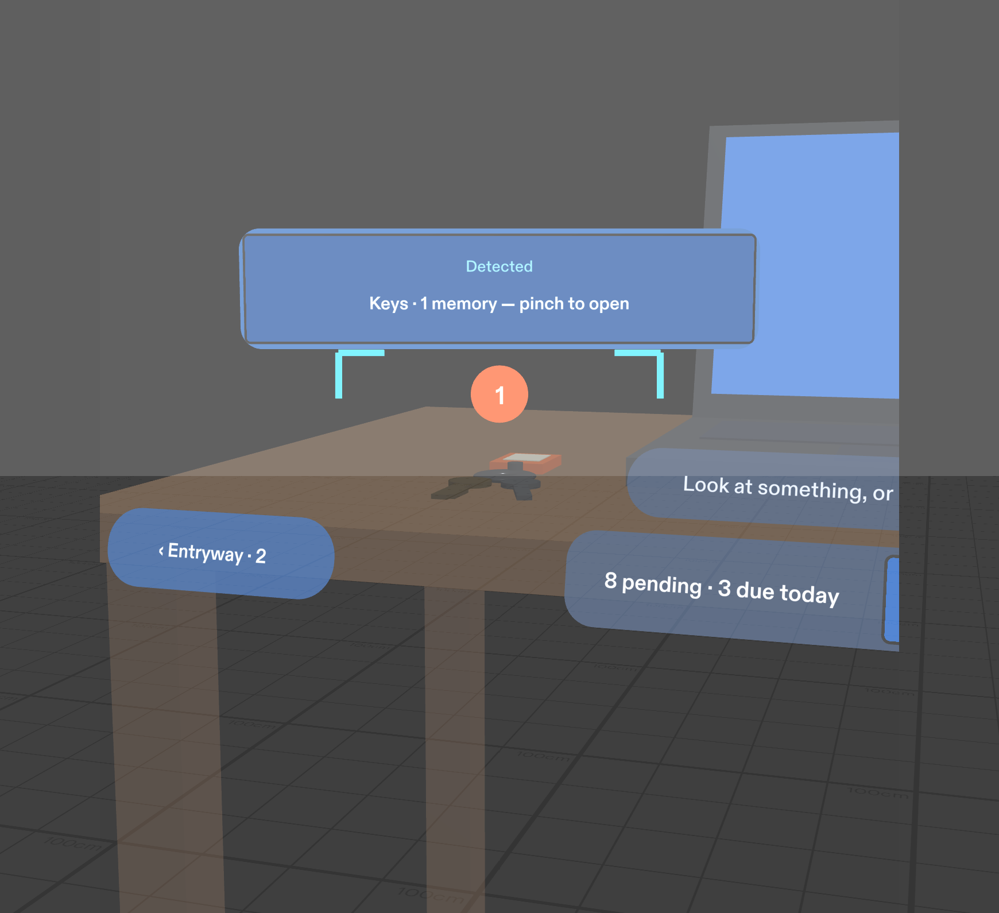
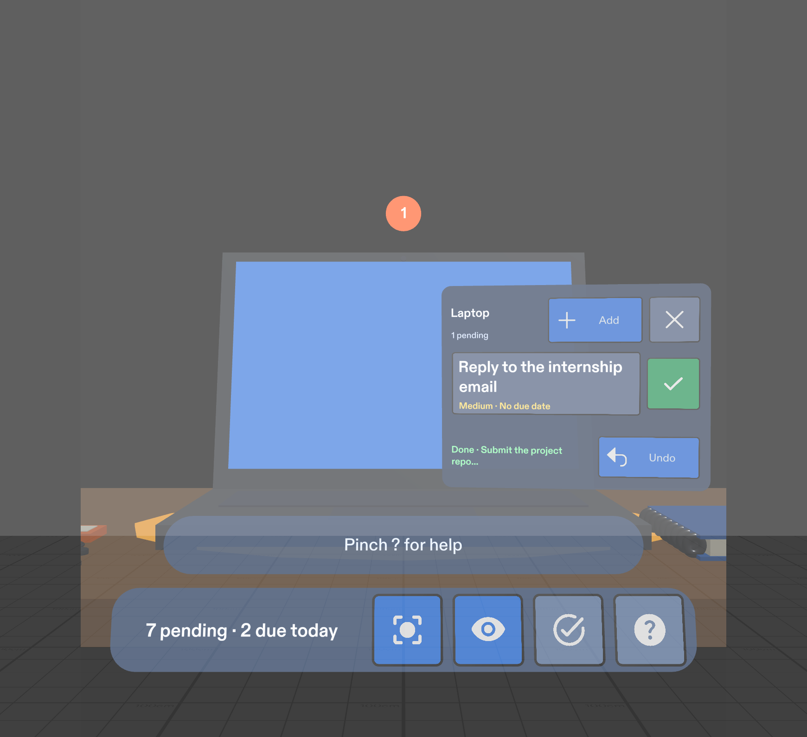
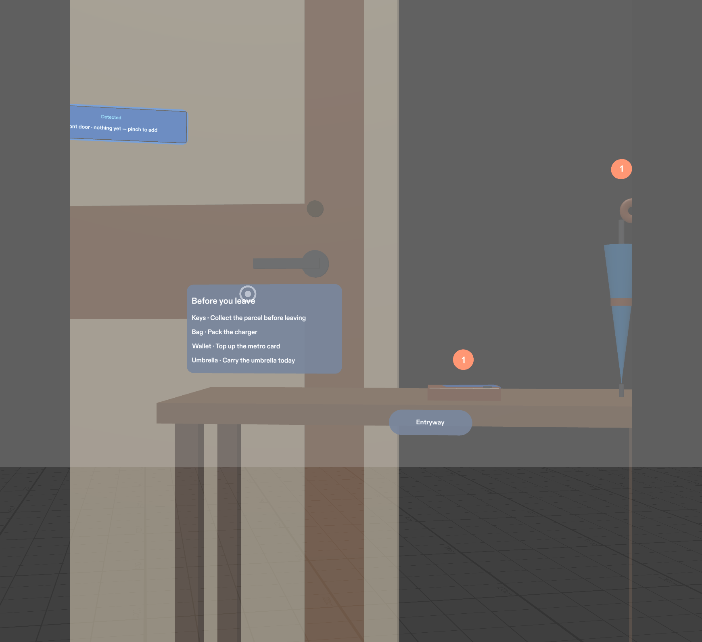

# MEMAR

*Your real world. Your memories.*

A Lens for **Snap SPECS** that puts reminders on the things they're about. Entry for the Devpost hackathon **Learn AR with SPECS**.

**Try it now on your phone:** [https://xstranger-7.github.io/MEMAR/](https://xstranger-7.github.io/MEMAR/). This web simulator runs the same memory engine as the Lens; tap = pinch. The SPECS Lens itself is this repo: see [Open and run](#open-and-run).

Reminder apps store things well but surface them at the wrong moment. MEMAR puts each memory on the object it belongs to. A small dot above your laptop, keys or medicine box shows what's waiting, and looking at the object, or pinching it, opens its memories right beside it.

| Look to detect | Done, with Undo | Before you leave |
|---|---|---|
|  |  |  |

*Lens Studio preview captures of the SPECS Lens.*

## Features

**Memories on objects**
- **Badges on objects.** Each stand-in shows its pending count; no dot when nothing is waiting.
- **Recall by object.** Pinch an object and a card opens next to it, fully inside the narrow SPECS view, most urgent first (overdue → priority → due time).
- **Look to detect.** Hold your gaze on an object for about a second: detection brackets lock on and a chip offers "Keys · 1 memory — pinch to open". In the preview this is simulated from head direction; a camera recogniser would plug into the same `selectObject()` call, and MEMAR always asks you to confirm with a pinch.
- **Scan.** Tags every object in view with its count for a few seconds.

**Three setups, small and big things**
- **Desk** (laptop, keys, notebook, bag on a chair).
- **Entryway** on your left (front door, wallet, umbrella).
- **Kitchen** on your right (fridge, medicine box, water bottle).
- Hints on the desk edge ("◀ Entryway · 2", "Kitchen · 2 ▶") point to memories outside your view.

**Everyday use**
- **Done + Undo.** Pinch ✓; Undo stays for 8 seconds.
- **Routine memories.** Daily or weekly (e.g. "Take vitamin D after lunch") come back by themselves after Done.
- **Snooze.** "Later +1h" from the details view.
- **Before you leave.** A panel by the front door lists what's still pending on the things you carry (keys, bag, wallet, umbrella, bottle), or "All set to leave ✓".
- **Add without typing.** Quick presets per object, or **Speak** one sentence: it shows a cleaned-up title ("remind me to print the lab report" → "Print the lab report") and saves only when you pinch **Save**.
- **Details.** Priority (low/medium/high), Repeat (once/daily/weekly), Delete with confirmation.
- **Done list.** The last 5 finished memories, with **Restore** and **Clear done**.
- **Help card (?)** with the four things to know; first-run hint on the desk.
- **Honest saving.** Memories are written to Lens persistent storage after every change; a failed write shows "Couldn't save".

## Open and run

1. Install **Lens Studio 5.23.2** or newer (5.22+ required).
2. Clone this repo and open `MEMAR.esproj` (the Lens and the folder are both named MEMAR). Target: **SPECS**.
3. In the **Preview** panel (Interactive Preview):

   | Action | Control |
   |---|---|
   | Walk | W A S D |
   | Down / up | Q / E |
   | Look around | Right-drag |
   | Pinch | Click |

4. For a fresh demo every time, select **MemoraApp** and tick **resetOnStart**.
5. For voice capture, turn on the Preview microphone (the mic icon at the bottom-left of the Preview panel) and be online.

Full walkthrough, everyday routines and troubleshooting: [docs/07_USER_GUIDE.md](docs/07_USER_GUIDE.md).

**Where it runs:** Lens Studio Preview (tested) and SPECS glasses (built for them, not yet tested on hardware). The Lens doesn't run on a phone: it's a glasses Lens with 3D placement and hand pinches.

**Web simulator (no glasses, any browser or phone):** `npm run sim:serve`, then open http://localhost:8080 (or your laptop's IP on the same Wi-Fi). It runs the same engine code, bundled from `Assets/Scripts/Memora` by `tools/build-web-sim.js`, with tap-to-pinch, presets, typed or spoken memories, routines, snooze, the Done list and the leave-home check. Memories persist in the browser across reloads. It's a test tool, not the glasses experience.

**Hosted live demo:** `.github/workflows/pages.yml` publishes `web-sim/` to GitHub Pages on every push to `main` (one-time setup: Settings → Pages → Source: GitHub Actions). Live link: **https://xstranger-7.github.io/MEMAR/**. It works on any phone with no install.

**Videos:** `python tools/make_videos.py` builds `media/MEMAR_Intro.mp4` and the narrated `media/MEMAR_Demo.mp4` (with `MEMAR_Demo.srt` captions). The demo opens with an illustrated concept of MEMAR on real glasses (labelled on screen), then shows the real Lens in the preview and a live recording of the simulator (`tools/video/`).

## How it works

```
MemoraApp (component, top of the hierarchy)   owns the store, storage, selection
 ├─ MemoraStore       create / recall / complete / undo / routines / snooze / archive / counts
 ├─ MemoraStorage     Lens persistentStorageSystem adapter (+ session fallback, honest failures)
 ├─ MemoraObjects     10 objects in 3 zones, sizes, carry-along flags, layout maths
 ├─ MemoraSampleData  presets per object, demo seed (+ one-time top-up for new objects)
 ├─ MemoraDetector    look-to-recall: gaze cone, dwell lock, scan cone (pure maths)
 └─ MemoraVoice       transcript → clean title + priority
MemoraWorld (MemoraMain)                       scene orchestrator, re-anchored to the user at start
 ├─ Desk / Zone-entryway / Zone-kitchen        stand-ins (MemoraStandIn + catalog), badges, labels
 ├─ TodayStrip                                 counts, Scan / Look / Done list / Help, zone hints
 ├─ MemoryCard                                 list / presets / voice / details + confirm
 ├─ Detection                                  reticle, chip, scan tags (MemoraDetection)
 ├─ ArchivePanel, HelpCard, LeaveCheck         Done list, help, "Before you leave"
 └─ Voice, Audio                               ASR capture (MemoraVoiceInput), soft UI sounds
```

The engine (`Assets/Scripts/Memora`) is pure TypeScript with no scene dependencies, so it runs in Lens Studio and in Node. UI scripts (`Assets/Scripts/MemoraUI`) read the store and re-render on every change; they never keep their own copy of memories.

**Recognition seam:** every path calls `MemoraApp.instance.selectObject(id, via)`. Today that's a pinch or a confirmed gaze lock on a stand-in. A future image-target or on-device recogniser calls the same method, after the user confirms.

**Card placement** (`MemoraPlacement.ts`): the SPECS view is about 37° wide, so the card opens in front of the selected object, on the side toward the middle of your view, within arm's reach, scaled to a constant visual size. The object's badge stays visible.

## Tests

**Engine (Node):** `npm test` → **41 pass, 0 fail**. Four files:
- `memora-store`: validation, recall, double-pinch guard, Done/Undo, edit, delete, due states, ordering, save/load, corrupted data, storage failures, seed.
- `memora-detector`: gaze, dwell, scan.
- `memora-features`: zones, catalog, archive, voice, seed top-up.
- `memora-daily`: routines, snooze, leave-home check.

**LEAF (Lens Studio preview):** one scenario per done criterion (`Assets/Scripts/Tests`). Final pass on the final build, run serially from a fresh preview: **14 / 14 PASS**, 51 real SIK pinches, 0 retries. "Real pinch" = LEAF's simulated hand driving SIK's interactor (hover → trigger). Objects outside the start view are reached by turning MemoraWorld (a test-side head turn).

| # | Done criterion | Result |
|---|---|---|
| 1 | Badges at start: laptop 2, keys 1, bag 1, notebook none | PASS (read-only checks) |
| 2 | Pinch laptop → only laptop memories, report first; pinch keys → card moves | PASS (3 real pinches) |
| 3 | Done → badge and strip drop; Undo restores | PASS (3 real pinches) |
| 4 | Notebook → + Add → preset adds one (double pinch still one) | PASS (4 real pinches, 2nd press 0.2 s later) |
| 5 | Delete asks; Cancel keeps, Confirm removes | PASS (7 real pinches) |
| 6 | Entryway/kitchen badges and zone hints | PASS (read-only checks) |
| 7 | Look-to-detect chip → pinch opens the card | PASS (gaze hook + real pinch; also a real dwell lock on the bag) |
| 8 | Done list shows the finished memory; Restore puts it back | PASS (5 real pinches) |
| 9 | Speak → preview → Save adds, Cancel doesn't | PASS (7 real pinches; transcript via test hook, real speech not automated) |
| 10 | Scan tags objects in view | PASS (1 real pinch) |
| 11 | Daily routine comes back tomorrow; Undo leaves no duplicate | PASS (3 real pinches) |
| 12 | Snooze moves the due time ~1 h | PASS (5 real pinches, +60.0 min) |
| 13 | "Before you leave" lists carry items, then "All set" | PASS (8 real pinches) |
| 14 | Help card opens and closes | PASS (2 real pinches) |

**Manual user test (preview, real clicks):** cards open fully in view for the laptop, keys, wallet and bag. Done on the laptop drops the badge 2 → 1 and the strip 8 → 7. Done by mouse click on the bag shows the empty state and Undo. The door panel lists Keys, Bag, Wallet, Umbrella.

**Logic proven:** the rows above that pass. **Feel unproven:** persistence across restarts on real glasses, comfort over time, real recognition, real hand tracking, real speech in noisy rooms.

## Project layout

| Path | What it is |
|---|---|
| `Assets/Scripts/Memora/` | Memory engine (pure TS) and app root |
| `Assets/Scripts/MemoraUI/` | Scene and UI scripts built with CLAD |
| `Assets/Scripts/Tests/` | LEAF scenarios |
| `Assets/Materials`, `Meshes`, `Icons`, `GeneratedSFX` | Stand-in materials, primitive meshes, Material icons, generated UI sounds |
| `tests/` | Node unit tests for the engine |
| `devpost/design-brief.md` | Design brief from the plan-lens interview |
| `docs/` | Setup, user guide, test plan, demo script, Devpost write-up |

## How it was made

- **Planned** from the owner's MEMAR blueprint and the Devpost Learn skill pack (`plan-lens`, [challengepost/learn-specs](https://github.com/challengepost/learn-specs)) → `devpost/design-brief.md`.
- **Built** by Claude Code through **CLAD** (the `ls-clad` plugin: SPECS Experience Builder, Live Lens Tester) with **Lens Studio** and the **Lens Studio MCP**, in three build passes: desk MVP; zones, detection, voice and archive; daily-life features and polish. Each pass was verified in the preview with real SIK pinches and screenshots.
- **Tested** with LEAF in the preview and Node unit tests for the engine.

## Pre-existing code and assets

- **Lens Studio SPECS Base Template** (Lens Studio 5.23.2).
- **Spectacles Interaction Kit 0.18.0** and **Spectacles UI Kit**, as shipped with the template, unchanged.
- **Leaf 2.0.2**, **AI Preview Agent Inspect / Interact** (testing tools), **Icons** and **Motion** packages from the Lens Studio Asset Library, unchanged. `Assets/Scripts/Typings/AiPreviewAgentInspectCompat.d.ts` only declares types so the Inspect package's unused examples compile.
- **plan-lens** skill (challengepost/learn-specs, MIT), used for planning.
- The memory engine in `Assets/Scripts/Memora/` and the Node tests were written with an AI assistant (Claude) during the hackathon (9 Nov 2026), then extended (zones, detection, voice, routines) during the build.
- Icons: Google Material Icons. Sounds: generated locally (no samples).

## Privacy

- No camera capture, no recording, nothing about other people.
- The microphone is used only after you pinch **Speak**, for one sentence. Speech is transcribed by Snap's speech-to-text service; only the text you choose to save is stored.
- Memories stay on the device in Lens storage, and delete is always available.

## License

MIT
